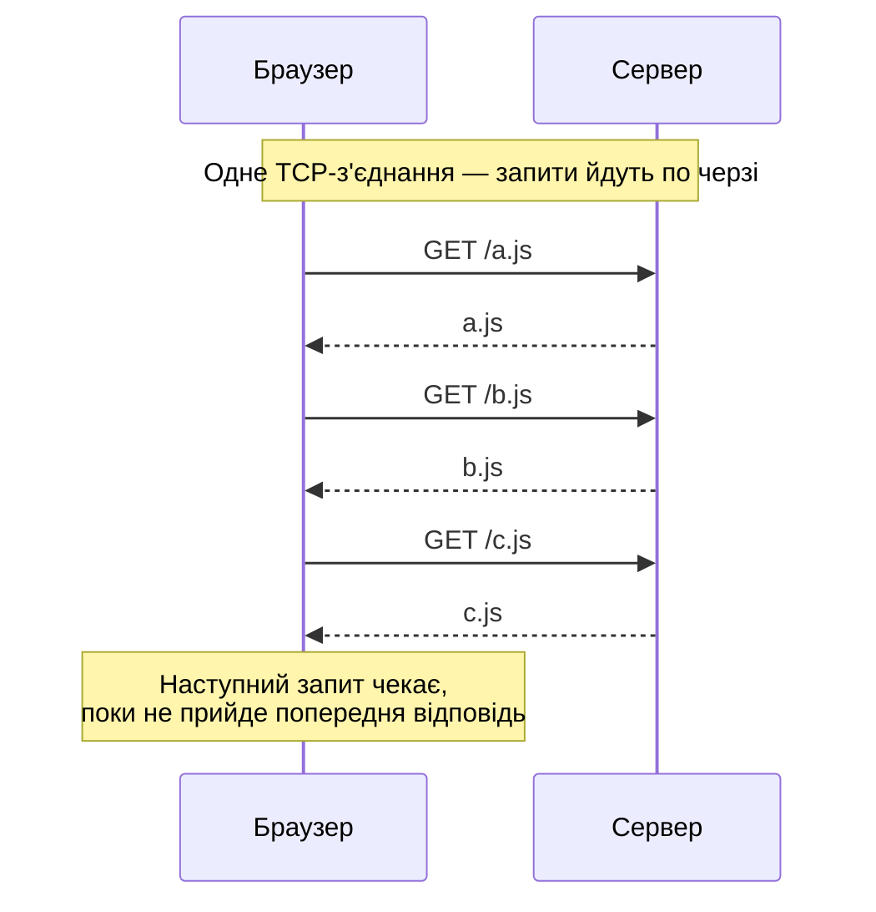
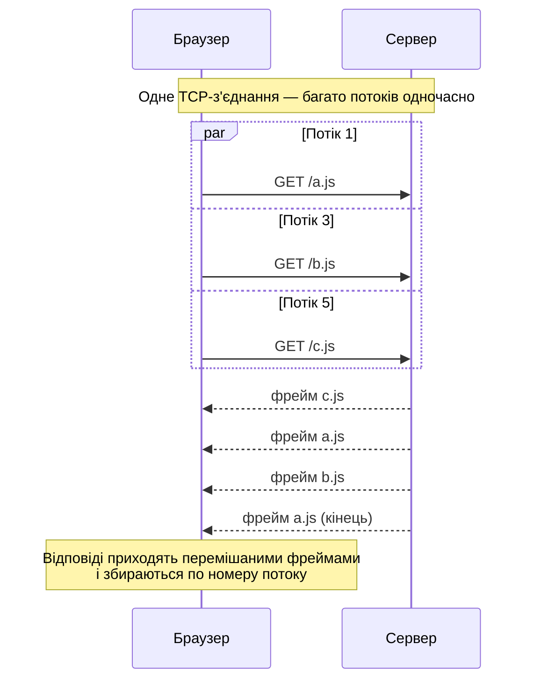
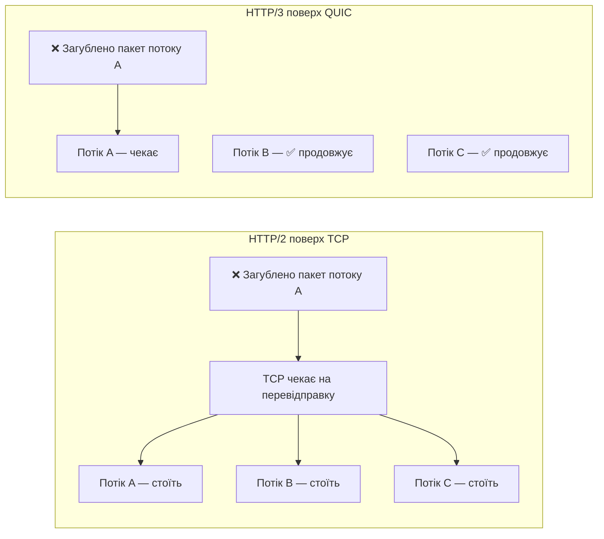
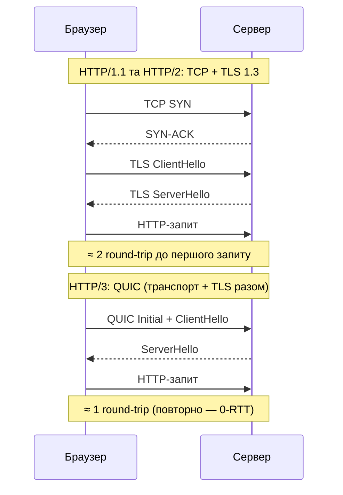
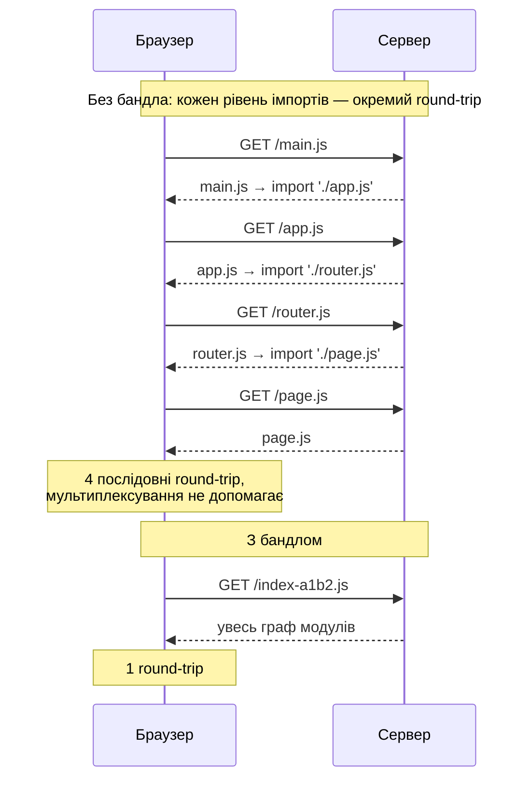
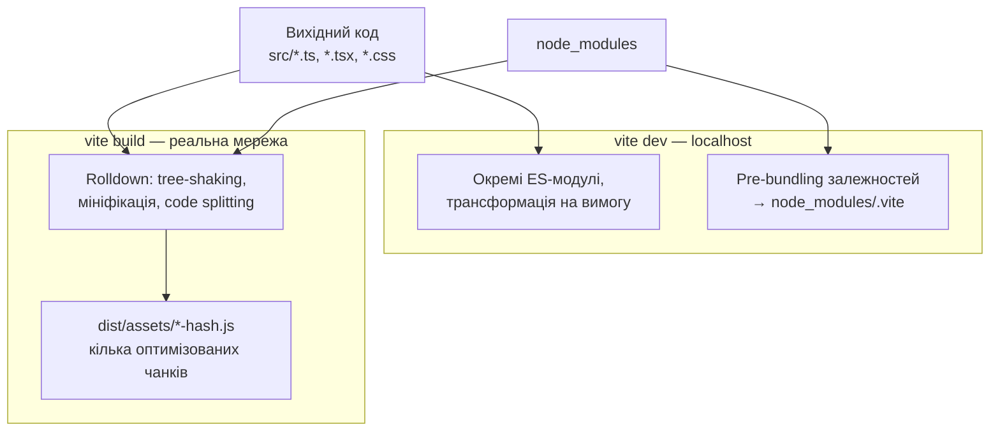

# HTTP/1.1 vs HTTP/2 vs HTTP/3 і до чого тут бандлери

> Діаграми написані на Mermaid — вони відображаються на GitHub, GitLab, у VS Code (з розширенням Markdown Preview Mermaid Support), Obsidian, Notion.

## Коротко

| | HTTP/1.1 | HTTP/2 | HTTP/3 |
|---|---|---|---|
| Рік | 1997 | 2015 | 2022 |
| Транспорт | TCP | TCP | **QUIC (поверх UDP)** |
| Формат | Текстовий | Бінарний (фрейми) | Бінарний (фрейми) |
| Запитів на одне з'єднання одночасно | 1 | Багато (**мультиплексування**) | Багато (мультиплексування) |
| Стиснення заголовків | Немає | HPACK | QPACK |
| Head-of-line blocking | На рівні HTTP і TCP | Лише на рівні TCP | **Немає** (потоки незалежні) |
| Шифрування | Опційне | Фактично обов'язкове в браузерах | Вбудоване (TLS 1.3) |
| Встановлення з'єднання | TCP + TLS (кілька round-trip) | TCP + TLS | 1 round-trip, можливо 0-RTT |

---

## HTTP/1.1

- Одне TCP-з'єднання обробляє **один запит за раз**: поки не прийшла відповідь, наступний запит чекає.
- Браузери відкривають до **~6 з'єднань на домен** — тобто максимум ~6 файлів паралельно.
- Кожен запит несе повні текстові заголовки (cookies, User-Agent тощо) — для дрібних файлів заголовки можуть бути більшими за сам файл.

**Наслідок:** 300 дрібних JS-файлів = 300 запитів у черзі по 6 штук. Повільно.

**Хаки тієї епохи:** бандлінг JS/CSS в один файл, CSS-спрайти, inline-зображення (base64), domain sharding (статика на кількох піддоменах).

## HTTP/2

- **Мультиплексування:** багато запитів і відповідей одночасно через одне з'єднання, перемішаними фреймами.
- **Стиснення заголовків (HPACK):** повторювані заголовки майже нічого не коштують.
- **Пріоритизація** потоків.
- Server Push — був у специфікації, але на практиці не прижився, браузери його прибрали.

**Залишкова проблема:** усе йде через один TCP. Якщо загубився один пакет, TCP зупиняє **всі** потоки, доки пакет не буде перевідправлено (TCP head-of-line blocking). Особливо помітно на мобільних мережах.

## HTTP/3

- Працює поверх **QUIC** (UDP), а не TCP.
- Втрата пакета блокує **лише свій потік**, решта продовжують.
- Швидше з'єднання: TLS 1.3 вбудований, встановлення за 1 round-trip (для повторних — 0-RTT).
- **Міграція з'єднання:** перехід з Wi-Fi на мобільний інтернет не розриває з'єднання.

### Втрата пакета: HTTP/2 vs HTTP/3

### Встановлення з'єднання

---

## Чи правильно, що бандлери з'явилися через проблему «багатьох дрібних файлів»?

**Частково так.** Обмеження HTTP/1.1 — одна з головних історичних причин бандлінгу. Але не єдина, і саме тому бандлери не зникли з приходом HTTP/2 і HTTP/3.

### Інші причини існування бандлерів
1. **Модулі.** До ES-модулів у браузері (≈2017) не було нативного `import` — бандлер склеював CommonJS/AMD-модулі в робочий код.
2. **npm-пакети.** Браузер не розуміє `import React from 'react'` — потрібне розв'язання шляхів до `node_modules`.
3. **Трансформації:** TypeScript, JSX, SCSS, новий синтаксис для старих браузерів.
4. **Оптимізації:** мініфікація, tree-shaking, хешування імен для кешу, code splitting.

### Чому навіть з HTTP/2/3 файли все одно бандлять для production
- **Водоспад імпортів (waterfall).** Браузер дізнається про `b.js` лише після завантаження й розбору `a.js`, який його імпортує. Глибоке дерево імпортів = багато послідовних round-trip, і мультиплексування тут не допомагає, бо запити не можна відправити, доки про них не відомо.

- **Стиснення** (gzip/brotli) ефективніше на більших файлах.
- **Кожен запит має накладні витрати** — менші, ніж у HTTP/1.1, але не нульові (сотні чи тисячі модулів відчутні).
- **Tree-shaking** потребує аналізу всього графа модулів.

### Як це пов'язано з Vite
- **Dev-режим:** Vite віддає код як окремі нативні ES-модулі. Локально (localhost) мережеві затримки мізерні, тому сотні запитів не проблема — зате немає повного перезбирання при кожній зміні.
- **Залежності** (`node_modules`) Vite все одно попередньо збирає, бо деякі пакети складаються з сотень модулів — навіть локально це помітно сповільнювало б завантаження.
- **Production:** Vite збирає бандл (Rolldown у Vite 8), бо в реальній мережі водоспад імпортів і накладні витрати на запити важать.

### Що змінилося на практиці
| Епоха | Стратегія |
|---|---|
| HTTP/1.1 | «Один великий файл» — мінімум запитів будь-якою ціною |
| HTTP/2/3 | «Розумний поділ на чанки» — кілька середніх файлів: окремо vendor-код, окремо сторінки, ліниве завантаження через `import()`. Краще кешування: зміна одного модуля не інвалідує весь бандл |

**Висновок:** HTTP/2 і HTTP/3 зробили гранулярні бандли вигіднішими і прибрали старі хаки (спрайти, domain sharding), але не скасували бандлінг — він вирішує набагато більше задач, ніж лише кількість запитів.
