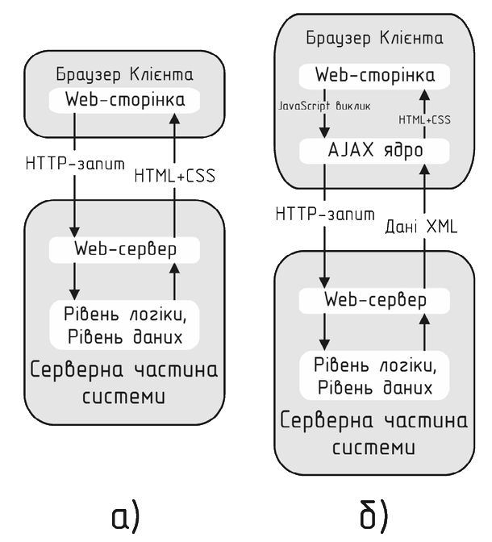
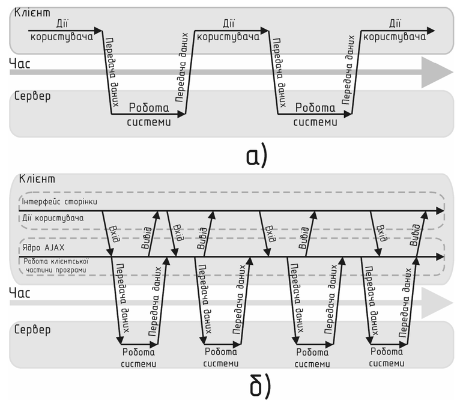

# Асинхронний веб та робота з API в TypeScript: AJAX, XHR, Fetch API та безпечна типізація

---

## 1. Концепція та призначення AJAX

### 1.1 Що таке AJAX?

**AJAX** (*Asynchronous JavaScript and XML*) — це підхід до розробки веб-додатків, що дозволяє клієнтській частині взаємодіяти з веб-сервером у фоновому асинхронному режимі без повного перезавантаження HTML-сторінки.

AJAX – не є самостійною технологією, а концепцією використання декількох суміжних технологій. AJAX базується на двох основних принципах:
* використання технології динамічного звернення до сервера, без перезавантаження сторінки повністю
* використання Dynamic HTML для динамічної зміни змісту сторінки;

Традиційна модель Web 1.0 вимагала надсилання форми чи кліку на посилання з наступним завантаженням нового HTML-документа від сервера. AJAX переніс роботу на клієнт: сторінка завантажується один раз (SPA — Single Page Application або MPA з динамічними віджетами), а дані передаються у форматі JSON у фоні за допомогою JavaScript/TypeScript.

```
Традиційний підхід:
[Клієнт / Браузер]  ─── HTTP GET / POST ───►  [Сервер]
[Білий екран/Reload] ◄── Нова HTML-сторінка ───  [Рендеринг HTML]

AJAX підхід:
[Клієнт / Браузер]  ─── Асинхронний запит (JSON) ───► [REST / GraphQL API]
[DOM оновлюється]   ◄── Сирі дані (JSON/XML) ───────  [Обробка бізнес-логіки]
```

<br>

<br>

Переваги використання AJAX:
* Економія трафіка. Використання AJAX дозволяє суттєво скоротити трафік при роботі з web-додатком завдяки тому, що часто замість завантаження цілої сторінки достатньо завантажити тільки ту частину, що змінилася, яка за звичай є невеликою.
* Зменшення навантаження на сервер. AJAX дозволяє дещо знизити навантаження на сервер. Для прикладу, якщо користувач на деякій сторінці відмітив записи для видалення, серверу достатньо внести зміни в базу даних, а клієнту повернути результат цього виконання – деяку змінну без необхідності генерувати нову сторінку, за результатами виконання операції сторінка буде згенерована на клієнтській частині.
* Пришвидшення реакції інтерфейсу. Оскільки необхідно завантажити лише ту частину сторінки, що змінилась, користувач бачить результат своїх дій швидше.

### 1.2 Роль TypeScript у роботі з віддаленими API

У чистому JavaScript результат виклику `response.json()` повертає динамічний об'єкт, з яким розробник працює наосліп. Це породжує ризики помилок:
* Зміна назв полів бекенд-розробником (наприклад, `user_id` замість `id`);
* Неочікувані значення `null` або `undefined`;
* Відсутність автодоповнення (IntelliSense) у коді обробки відповіді.

TypeScript додає шар **статичної типізації контрактів** між клієнтом і сервером, забезпечуючи передбачуваність роботи з даними.

> **Короткий зміст (Slide Summary):** AJAX дозволяє фоново обмінюватися даними з сервером без перезавантаження сторінки. TypeScript забезпечує строгу типізацію та захист від невідповідності схем API.
>
> 💬 **Питання для дискусії:** *Чому незважаючи на наявність літери "X" (XML) в абревіатурі AJAX, 99% сучасних додатків використовують формат JSON?*

---

## 2. XMLHttpRequest (XHR): Історія та низькорівнева робота

`XMLHttpRequest` — це перший нативний браузерний об'єкт для виконання HTTP-запитів, що з'явився ще на початку 2000-х. Хоча в сучасній розробці частіше використовують Fetch API або бібліотеки на кшталт Axios, розуміння XHR є критичним для:
1. Роботи з легасі-кодом;
2. Відстеження точного прогресу завантаження файлів на сервер (`xhr.upload.onprogress`), що в нативному Fetch реалізується значно складніше.

### 2.1 Типізація обгортки над XHR на базі Promise

Класичний XHR побудований на колбеках та подіях (`readystatechange`, `load`, `error`). Огорнемо його в універсальну типізовану функцію на основі `Promise<T>`:

```typescript
export interface XhrRequestConfig {
  method: "GET" | "POST" | "PUT" | "DELETE" | "PATCH";
  url: string;
  headers?: Record<string, string>;
  body?: unknown;
  timeoutMs?: number;
}

export function sendXhrRequest<TResponse>(config: XhrRequestConfig): Promise<TResponse> {
  return new Promise<TResponse>((resolve, reject) => {
    const xhr = new XMLHttpRequest();
    xhr.open(config.method, config.url, true);

    if (config.timeoutMs) {
      xhr.timeout = config.timeoutMs;
    }

    // Встановлення HTTP-заголовків
    xhr.setRequestHeader("Accept", "application/json");
    if (config.body) {
      xhr.setRequestHeader("Content-Type", "application/json");
    }

    if (config.headers) {
      for (const [key, value] of Object.entries(config.headers)) {
        xhr.setRequestHeader(key, value);
      }
    }

    // Обробка успішного завершення
    xhr.onload = () => {
      if (xhr.status >= 200 && xhr.status < 300) {
        try {
          const parsedData: TResponse = JSON.parse(xhr.responseText);
          resolve(parsedData);
        } catch (err) {
          reject(new Error("Помилка парсингу JSON-відповіді"));
        }
      } else {
        reject(new Error(`HTTP Помилка: ${xhr.status} ${xhr.statusText}`));
      }
    };

    // Обробка мережевих збоїв та таймаутів
    xhr.onerror = () => reject(new Error("Мережева помилка (Network Failure)"));
    xhr.ontimeout = () => reject(new Error(`Перевищено ліміт очікування (${config.timeoutMs}мс)`));

    const payload = config.body ? JSON.stringify(config.body) : null;
    xhr.send(payload);
  });
}
```

> **Короткий зміст (Slide Summary):** `XMLHttpRequest` базується на подіях (event-driven). Для використання в сучасному коді його огортають у типізований `Promise<T>`, обробляючи `onload`, `onerror` та парсинг тексту.

---

## 3. Сучасний Fetch API в TypeScript

**Fetch API** — це сучасний браузерний стандарт для виконання мережевих запитів, заснований на Promise та потоках (Streams).

### 3.1 Ключові особливості поведінки `fetch()`:
1. **Fetch НЕ відхиляє (reject) Promise при статусах 4xx та 5xx!**
   * Promise відхиляється лише у разі критичного апаратного збою мережі або блокування CORS.
   * Перевірку коду відповіді обов'язково треба робити самостійно через поле `response.ok` (булеве значення: статус у діапазоні 200–299).
2. **Метод `response.json()` повертає `Promise<any>` за замовчуванням у стандартних типах TypeScript.**

### 3.2 Базовий виклик та типізація

```typescript
interface UserProfile {
  id: number;
  name: string;
  email: string;
  isActive: boolean;
}

async function loadUserProfile(userId: number): Promise<UserProfile> {
  const response = await fetch(`https://api.example.com/users/${userId}`);

  // Критична перевірка: без неї помилка 404/500 перейде до блоку json()
  if (!response.ok) {
    throw new Error(`Не вдалося завантажити профіль. Статус: ${response.status}`);
  }

  // Оскільки response.json() повертає Promise<any>, робимо явне уточнення типу:
  const data: UserProfile = await response.json();
  return data;
}
```

### 3.3 Скасування запитів через `AbortController`

Сучасний підхід до керування життєвим циклом запитів (наприклад, коли користувач перейшов на іншу вкладку чи ввів новий запит у пошуку):

```typescript
async function fetchWithCancellation(url: string, signal: AbortSignal): Promise<unknown> {
  try {
    const res = await fetch(url, { signal });
    return await res.json();
  } catch (error) {
    if (error instanceof DOMException && error.name === "AbortError") {
      console.warn("Запит скасовано користувачем");
    } else {
      console.error("Інша помилка мережі:", error);
    }
    throw error;
  }
}

// Приклад використання:
const controller = new AbortController();
fetchWithCancellation("https://api.example.com/heavy-data", controller.signal);

// Скасувати через 2 секунди, якщо сервер не відповів:
setTimeout(() => controller.abort(), 2000);
```

> **Короткий зміст (Slide Summary):** `fetch()` простіший за XHR, але не викидає виняток при помилках 404/500, що вимагає перевірки `res.ok`. Для скасування запитів використовується `AbortController`.
>
> 💬 **Питання для дискусії:** *Чому стандартні типи TypeScript для `fetch().then(r => r.json())` повертають `Promise<any>`, а не `Promise<unknown>`?*

---

## 4. Стратегії типізації відповідей сервера

Отримані через мережу дані приходять з неконтрольованого середовища. TypeScript перевіряє типи лише під час компіляції (**compile-time**), але під час виконання (**runtime**) сервер може повернути несподіваний JSON.

Розглянемо три рівні надійності типізації:

```
[Рівень 1: Небезпечний]   response.json() as MyType         (Сліпа довіра компілятора)
                                     │
                                     ▼
[Рівень 2: Захищений]     Type Narrowing + Type Guards      (Перевірка кодом у runtime)
                                     │
                                     ▼
[Рівень 3: Enterprise]    Схематична валідація (Zod/Valibot)(Автоматична валідація та вивід типів)
```

### 4.1 Рівень 1: Приведення типів (Type Assertion `as`)

Найпростіший, але вразливий метод:

```typescript
interface Post {
  id: number;
  title: string;
  body: string;
}

// Ми говоримо компілятору: "Вір мені, сервер точно віддасть цю структуру"
const post = (await response.json()) as Post;
```
*Мінус:* Якщо бекенд перейменує поле `body` на `content`, компілятор TS не повідомить про це, і помилка виникне в інтерфейсі користувача.

### 4.2 Рівень 2: Безпечна типізація через Type Guards (`unknown` + предикат `is`)

Найбезпечніший спосіб без використання зовнішніх бібліотек:

```typescript
export interface ApiResponse<T> {
  success: boolean;
  data: T;
  timestamp: number;
}

export interface UserSummary {
  id: number;
  username: string;
  roles: string[];
}

// Custom Type Guard для перевірки форми об'єкта під час виконання
function isUserSummary(data: unknown): data is UserSummary {
  if (typeof data !== "object" || data === null) {
    return false;
  }

  const candidate = data as Record<string, unknown>;

  return (
    typeof candidate.id === "number" &&
    typeof candidate.username === "string" &&
    Array.isArray(candidate.roles) &&
    candidate.roles.every((role) => typeof role === "string")
  );
}

// Безпечний клієнтський виклик
async function fetchSafeUser(url: string): Promise<UserSummary> {
  const response = await fetch(url);
  if (!response.ok) {
    throw new Error(`HTTP Error: ${response.status}`);
  }

  const rawJson: unknown = await response.json();

  if (!isUserSummary(rawJson)) {
    throw new Error("Отримані дані не відповідають очікуваному контракту UserSummary");
  }

  // Тут TypeScript впевнений, що rawJson — це UserSummary!
  return rawJson;
}
```

### 4.3 Уніфікована обгортка для роботи з API (Generic HTTP Client)

Створимо гнучкий і типізований клієнт, що об'єднує заголовки, параметри, обробку помилок та строгі інтерфейси:

```typescript
export type HttpMethod = "GET" | "POST" | "PUT" | "PATCH" | "DELETE";

export interface RequestOptions {
  method?: HttpMethod;
  headers?: Record<string, string>;
  body?: unknown;
  queryParams?: Record<string, string | number>;
}

export class ApiError extends Error {
  constructor(
    public readonly status: number,
    public readonly statusText: string,
    public readonly errorData: unknown
  ) {
    super(`Запит завершився помилкою [${status}]: ${statusText}`);
    this.name = "ApiError";
  }
}

export class HttpClient {
  constructor(private readonly baseUrl: string) {}

  public async request<TResponse>(endpoint: string, options: RequestOptions = {}): Promise<TResponse> {
    const { method = "GET", headers = {}, body, queryParams } = options;

    // Формування URL з Query Params
    let targetUrl = `${this.baseUrl}${endpoint}`;
    if (queryParams) {
      const searchParams = new URLSearchParams();
      for (const [key, value] of Object.entries(queryParams)) {
        searchParams.append(key, String(value));
      }
      targetUrl += `?${searchParams.toString()}`;
    }

    const requestHeaders: HeadersInit = {
      Accept: "application/json",
      ...headers,
    };

    let serializedBody: string | undefined;
    if (body !== undefined) {
      requestHeaders["Content-Type"] = "application/json";
      serializedBody = JSON.stringify(body);
    }

    const response = await fetch(targetUrl, {
      method,
      headers: requestHeaders,
      body: serializedBody,
    });

    if (!response.ok) {
      let errorPayload: unknown;
      try {
        errorPayload = await response.json();
      } catch {
        errorPayload = await response.text();
      }
      throw new ApiError(response.status, response.statusText, errorPayload);
    }

    // Для статусів 204 No Content
    if (response.status === 204) {
      return undefined as TResponse;
    }

    return (await response.json()) as TResponse;
  }

  public get<T>(endpoint: string, queryParams?: Record<string, string | number>): Promise<T> {
    return this.request<T>(endpoint, { method: "GET", queryParams });
  }

  public post<T>(endpoint: string, body: unknown): Promise<T> {
    return this.request<T>(endpoint, { method: "POST", body });
  }
}
```

> **Короткий зміст (Slide Summary):** Статичні типи TypeScript зникають після компіляції. Для надійного продакшен-коду відповіді варто валідувати за допомогою Type Guards або бібліотек схем (Zod), а логіку обробки запитів інкапсулювати в `HttpClient`.

---

## 5. Інтерактивні практичні завдання (Coding Exercises)

### Завдання 1: Безпечна обробка відповіді зі статусом помилки

**Умова:** Допишіть функцію, яка виконує GET-запит за вказаним URL. Якщо сервер повертає статус `404`, функція повинна повертати `null`. Якщо статус `200..299` — повертає типізовані дані. Для всіх інших статусів генерує виняток з текстом помилки.

```typescript
// ВИХІДНИЙ ШАБЛОН:
interface Article {
  id: string;
  title: string;
  content: string;
}

async function fetchArticleById(url: string, id: string): Promise<Article | null> {
  // Реалізуйте логіку тут
}
```

<details>
<summary>👉 Натисніть, щоб переглянути еталонне рішення</summary>

```typescript
async function fetchArticleById(url: string, id: string): Promise<Article | null> {
  const response = await fetch(`${url}/articles/${id}`);

  if (response.status === 404) {
    return null;
  }

  if (!response.ok) {
    throw new Error(`Мережевий запит завершився статусом ${response.status}`);
  }

  const article: Article = await response.json();
  return article;
}
```
</details>

---

### Завдання 2: Валідатор переліку сутностей (Array Type Guard)

**Умова:** Напишіть функцію-захисник типу `isTodoItemArray(data: unknown): data is TodoItem[]`, яка перевіряє, що отримані дані — це масив об'єктів, де кожен елемент містить `id` (число), `title` (рядок) та `completed` (булеве значення).

```typescript
interface TodoItem {
  id: number;
  title: string;
  completed: boolean;
}

// ВИХІДНИЙ ШАБЛОН:
function isTodoItemArray(data: unknown): data is TodoItem[] {
  // Реалізуйте перевірку типу
}
```

<details>
<summary>👉 Натисніть, щоб переглянути еталонне рішення</summary>

```typescript
function isTodoItemArray(data: unknown): data is TodoItem[] {
  if (!Array.isArray(data)) {
    return false;
  }

  return data.every((item) => {
    if (typeof item !== "object" || item === null) {
      return false;
    }
    const candidate = item as Record<string, unknown>;
    return (
      typeof candidate.id === "number" &&
      typeof candidate.title === "string" &&
      typeof candidate.completed === "boolean"
    );
  });
}
```
</details>

---

### Завдання 3: Discriminated Union для станів завантаження UI

**Умова:** Опишіть стан віддаленого запиту в компоненті за допомогою `Discriminated Union`. Стан повинен мати 4 варіанти:
1. `idle` — запит ще не починався;
2. `loading` — запит у процесі виконання;
3. `success` — запит успішний (містить поле `data: T`);
4. `error` — сталася помилка (містить поле `error: string`).

Напишіть функцію рендерингу повідомлення статусу.

```typescript
// ВИХІДНИЙ ШАБЛОН:
type AsyncState<T> = any; // замініть на розмічене об'єднання

function renderStatus<T>(state: AsyncState<T>): string {
  // Реалізуйте switch / if зі звуженням типів
}
```

<details>
<summary>👉 Натисніть, щоб переглянути еталонне рішення</summary>

```typescript
type AsyncState<T> =
  | { status: "idle" }
  | { status: "loading" }
  | { status: "success"; data: T }
  | { status: "error"; error: string };

function renderStatus<T>(state: AsyncState<T>): string {
  switch (state.status) {
    case "idle":
      return "Очікування дій користувача...";
    case "loading":
      return "Завантаження даних із сервера...";
    case "success":
      return `Дані успішно отримано: ${JSON.stringify(state.data)}`;
    case "error":
      return `Помилка запиту: ${state.error}`;
  }
}
```
</details>

---

## 6. Порівняльна таблиця: XHR vs Fetch API

| Критерій | `XMLHttpRequest` (XHR) | `Fetch API` |
| :--- | :--- | :--- |
| **Архітектурна парадигма** | На основі подій (Event-driven / Callbacks) | На основі обіцянок (`Promise` / Streams) |
| **Синтаксис** | Багатослівний, імперативний | Лаконічний, декларативний |
| **Підтримка в сучасних середовищах** | Лише браузери | Браузери, Node.js 18+, Deno, Bun, Cloudflare Workers |
| **Обробка HTTP-помилок (4xx, 5xx)** | Залишається в `onload`, перевірка статусу | Резолвить Promise, вимагає перевірки `res.ok` |
| **Скасування запиту** | `xhr.abort()` | `AbortController` / `signal` |
| **Відстеження прогресу Upload** | Вбудовано (`xhr.upload.onprogress`) | Складно (потребує ReadableStream у Request Body) |
| **Типізація за замовчуванням в TS** | `xhr.response: any` | `response.json(): Promise<any>` |

---

## 7. Підсумкова шпаргалка

* **Базовий Fetch з перевіркою статусу:**
  ```typescript
  const res = await fetch(url);
  if (!res.ok) throw new Error(`HTTP ${res.status}`);
  const data: ExpectedType = await res.json();
  ```
* **Fetch з типом `unknown` замість сліпого `any`:**
  ```typescript
  const raw: unknown = await res.json();
  if (isValidSchema(raw)) { /* безпечна робота */ }
  ```
* **Скасування довгого запиту:**
  ```typescript
  const ac = new AbortController();
  fetch(url, { signal: ac.signal });
  ac.abort(); // викликає AbortError
  ```
* **Обробка мережевих винятків:**
  ```typescript
  try {
    const data = await client.get<User[]>("/users");
  } catch (err) {
    if (err instanceof ApiError) {
      console.error(`Сервер відповів зі статусом ${err.status}`);
    }
  }
  ```